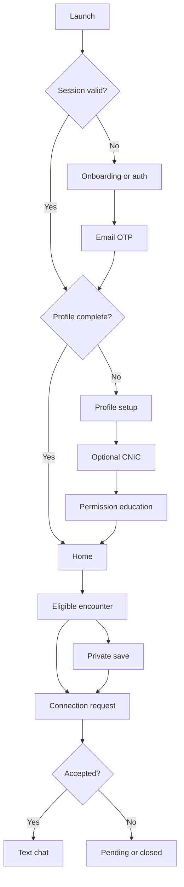
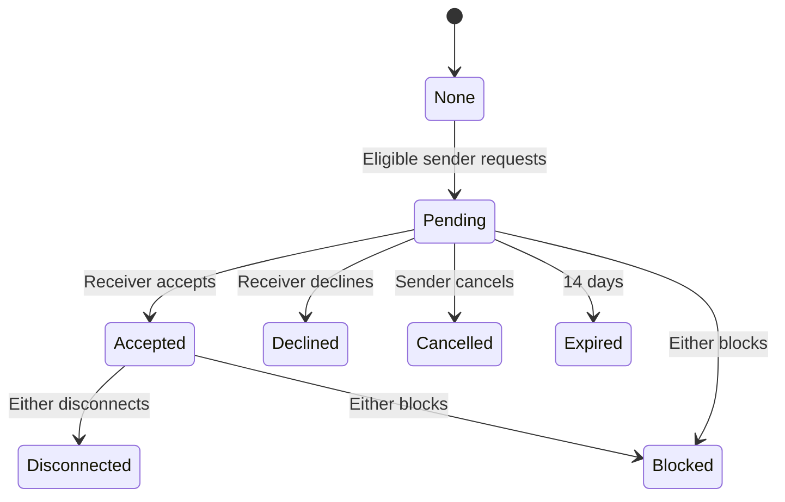

# Paths — Complete App Flow

Version 1.0 • 17 October 2026

## 1. Global routing order

On launch, render a static branded splash while reading session state; never add artificial delay. Evaluate in this order: deletion/deactivation status → authenticated session → email verification → profile completion → optional verification offer seen → permission education → Home. Restore an intended deep link only after guards pass and the server authorizes its resource.

First install: Splash → one onboarding screen → Sign up/Sign in. Returning signed-out users skip onboarding. Returning authenticated users resume incomplete setup or Home. Offline with a previously valid session can show cached nonsensitive UI, but no new matching or authorization-sensitive mutation is treated as successful.

## 2. Entry, authentication and profile setup

| Screen / route | Inputs and actions | Success destination | Exceptions |
|---|---|---|---|
| Splash `/` | Logo; session bootstrap | Guard-selected route | Network retry; never infinite spinner |
| Onboarding `/onboarding` | Single photo-led page; “Meet people you cross paths with”; Get started; policies link | `/auth/signup` | Existing-user sign-in link |
| Signup `/auth/signup` | Name/email/password, terms acknowledgment; password reveal | OTP challenge | Field validation, weak password, rate limit, resend unavailable |
| Sign-in `/auth/login` | Email/password; forgot password; final-phase Google/Apple buttons | Setup or Home | Invalid credentials generic; restricted account notice with support/delete access |
| OTP `/auth/otp` | Six digits; paste/autofill; resend timer; change email | Profile setup or reset-password depending on purpose | Invalid/expired/used OTP; attempts exhausted triggers new challenge |
| Forgot `/auth/forgot-password` | Email | Generic confirmation + reset OTP entry | Same visible response for nonexistent email |
| New password `/auth/reset-password` | New/confirm password, scoped reset grant | Sign-in with success notice | Expired grant returns to recovery; all sessions invalidated |
| Setup `/setup/profile` | Photo capture/gallery, username, private DOB, gender choice, bio | Optional verification | Under 18 blocked; username taken; upload retry preserves other fields |
| Verification `/setup/verification` | Explain optional review/retention; front/back upload; consent; submit/skip | Permissions then Home | Upload failure retry or skip; already pending shows status |
| Permission education `/setup/permissions` | Location rationale, precision explanation, push explanation | Home in any permission state | Denial is not an endless setup loop |

Profile age displayed as years, DOB never exposed. CNIC submission does not imply successful review. Skip marks offer seen; users can submit later in Settings. Setup progress persists server-side; avoid duplicating draft CNIC bytes in app backups.

## 3. Permissions

1. Explain “Paths uses your location to detect people you cross paths with. Other members see approximate encounter areas, not your exact location.” User selects enable or not now.
2. Ask foreground location using current platform UX. If approximate only, allow browsing but show reduced detection accuracy.
3. Separately explain background benefit and battery implications; request background permission through the platform-approved staged flow. No repeated prompts after denial; provide Settings link on explicit action.
4. Request notification permission when explaining encounter/request/message alerts; denial leaves in-app notification center usable.
5. Ask camera only on capture. Prefer system photo picker for gallery rather than broad media library access.

State handling: services off → enable-device-location instruction; permission denied → rationale + retry only when allowed; permanently denied → Settings link; foreground-only → foreground matching works, background marked unavailable; paused → resume CTA; low accuracy → explanation without fake encounters; offline → bounded encrypted queue, recent history available.

## 4. Main navigation

`StatefulShellRoute` preserves Home/Likes/Chats/Profile tab stacks and scroll positions. Center Camera button pushes a fullscreen modal and returns to the originating tab if canceled. Successful publishing opens own profile, highlights the post and leaves no stale capture modal.

### Home `/home`

Header: avatar/greeting, tracking status, notifications. Map is primary, with Recent/Nearby chips and radius control for Nearby. Bottom sheet/list contains authorized encounter cards. Map failure falls back to the same list.

- First empty state: “No paths crossed yet.” Explain opt-in/background limits; no fake sample profiles in production.
- Nearby empty state: “No recent encounters in this area.” Offer Recent without broadening eligibility.
- Tap approximate marker → encounter preview → full profile.
- Card: photo/name/age/badge, coarse area/time label, encounter count, save and request controls.
- Save toggles immediately with pending UI, rolls back on failure; private, no subject alert.
- Request action shows confirm/send; existing pending/connected state replaces CTA.
- Tracking status opens controls; pause immediately stops native collection and removes discovery visibility server-side when reachable. Local pause always takes effect immediately even offline.
- Offline pause is queued as highest-priority control; server cannot know about an offline change until contacted. Do not claim instantaneous remote invisibility without connectivity.

Notification tap `/notifications/:eventId` resolves destination after auth. Deleted/blocked/expired resource shows unavailable, without revealing the cause. Mark read only after successful authorized opening or explicit mark-read.

### Likes `/likes`

Three sections: Saved, Incoming, Sent. Saved shows private bookmarked profiles and request state. Incoming supports accept/decline and profile preview; Sent supports cancel. Empty, loading, offline, error/retry and expired states are distinct. No “people who liked you” section.

Request state machine:

Closed requests may be retried after seven days only with current/saved eligibility. Disconnected pairs require a new explicit request after the same cooldown. Unblock does not restore eligibility or a connection; fresh valid encounter required unless a new post-unblock encounter already exists.

### Other profile `/profiles/:id`

Header: avatar, name/username, age, gender choice, bio, badge explanation; approximate encounter summary only. Public posts display; private/unconnected posts show a clear lock panel. Save/request controls remain available based on eligibility. Connected state offers Chat and Disconnect. Overflow includes Report/Block. Changing privacy triggers access refresh, not merely a cosmetic lock icon.

### Camera `/camera` and preview `/posts/compose`

Open → permission → capture → retake or preview → optional caption → upload. Include gallery picker as alternative. While uploading, allow cancel with confirmation; orphan uploads cleaned by worker. Failure keeps a recoverable local draft only while authenticated. Upload completion enters safety review. Publication succeeds only after processing and image safety approval; pending post appears only to its owner, and pending profile photo uses a neutral public avatar. Cancel returns to origin. Permission denial never blocks unrelated app features.

### Chats `/chats` and thread `/chats/:conversationId`

Connections list shows last permitted text snippet in-app, unread count and conversation state. Select → cursor-based history → type → send via REST → pending bubble → durable server ACK → sent. Network failure shows retry; same clientMessageId prevents duplication. No read receipts/typing indicators required for v1.

Receiving realtime event reconciles by message ID/sequence. Reconnect loads messages after cursor; socket delivery never becomes the sole source of history. Deactivated/blocked/disconnected thread disables composer. Deleted peer removes the whole one-to-one thread on synchronization; stale screen becomes unavailable.

### Own profile `/profile`

Avatar/name/username/age/bio/badge; Instagram-style three-column post grid; edit profile; settings icon. Post detail offers delete with confirmation. No follower counts or social metrics invented from reference. Zero-post state links to camera.

### Settings `/settings`

Edit profile; public/private toggle; encounter pause/resume; location permission status/settings link; notifications (encounters/requests/messages/review); verification status/resubmit; change password; linked providers in final phase; active sessions/logout; blocked accounts; support/reporting; privacy/terms/community standards; Delete account.

Verify statuses: not submitted → pending → approved or declined. Decline shows a user-readable reason and resubmit, with no feature restriction. Previous document records remain while the account exists. Approved user may replace a document through a new pending review; badge status should follow the current accepted record unless admin explicitly revokes it.

## 5. Safety and account lifecycle

Report → choose profile/post/message → category → optional details → submit → reference acknowledgment. High-priority categories include suspected minor, threats, harassment, impersonation and sexual exploitation. Block is available immediately, independently of report review.

Deactivate by admin: revoke sessions, stop jobs/push/matching, hide listings, reject chat. User sees generic restricted-account screen with support and a reauthenticated deletion path. Reactivation does not restore old native tracking automatically without a valid resumed user session.

Delete: Settings → explanation (profile, CNIC, photos, encounter history and both-sided chat threads removed; timings) → reauthenticate → explicit Delete → server accepts → stop tracker/clear caches/sign out → receipt screen. Once accepted, no cancellation or auto-restoration on login. External deletion page uses email OTP and same backend workflow. If temporarily offline, explain deletion has not yet been submitted; do not pretend it succeeded.

## 6. Admin flow

Staff sign-in → MFA → overview. Verification queue → claim/open item → authorized document viewer → compare with submitted profile data as a manual plausibility check → approve/decline with reason → versioned commit → notification. If another reviewer acted first, refresh rather than overwrite.

User search → minimal account details/status → deactivate/reactivate with reason → audit → visible state update. Sensitive CNIC viewer requires separate permission. Report queue → scoped evidence → dismiss/warn/remove post/deactivate → audit and reporter acknowledgment where appropriate. No automatic CNIC authenticity assertion.

Public `/privacy`, `/terms`, `/community`, `/support`, `/delete-account` routes are isolated from admin API and staff shell. Admin routes may be hosted under a separate subdomain; web build/deployment must support SPA fallbacks without swallowing API endpoints.

## 7. Social sign-in final-phase flow

Google/Apple button → provider consent → backend token validation → existing provider identity or new account → adult/profile setup if incomplete → optional CNIC → Home. Provider supplies verified email: do not redundantly force email OTP unless additional email confirmation is required. Missing email invokes an email collection/verification step.

Email collision → explain existing account → reauthenticate existing account → explicitly link. Never create connection between accounts using email alone. Provider cancellation returns to auth without error alarm. Apple private relay supported. Last login method cannot be removed without adding another working method. Provider reauthentication is available for account deletion.
