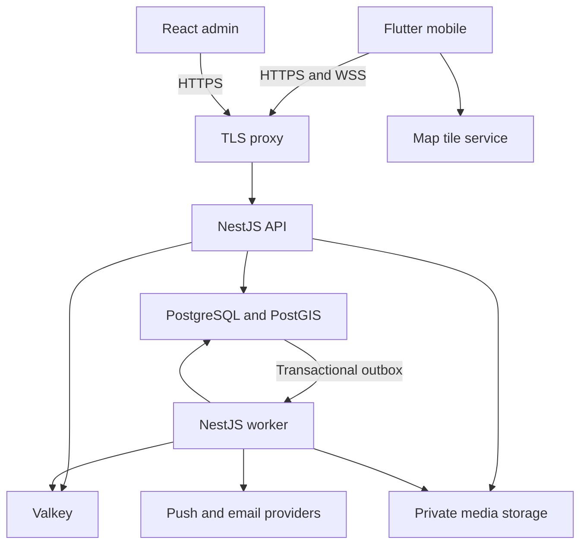

# Paths — System and UI Design

Version 1.0 • 17 October 2026 • Reference: supplied IMG_4661.JPG (included as Design_Reference.JPG in the ZIP)

## 1. System topology

The database defines durable truth. Worker failures do not erase committed events; outbox dispatch resumes. Mobile never receives peer exact coordinates or storage credentials. Tiles are a separate provider from location acquisition and encounter matching. Admin uses the same application authorization rules plus staff permissions.

## 2. Reference interpretation and fidelity

Reference contains onboarding, a card-based home and a map/profile sheet. Preserve pale aqua/blue surfaces, large rounded cards, black pill CTA, airy photo composition, thin line icons, white bottom bar and blue central orb treatment. Use Paths wordmark and the specified five destinations. Home opens map as requested; the card composition becomes encounter preview/list treatment.

| Reference element | Paths translation |
|---|---|
| Happn wordmark | Paths brand asset |
| “Perfect Match” dating text | Friendship/networking copy |
| 90–96% match labels | Omit; there is no matching-score feature |
| Boost/lightning/dislike controls | Omit; no boost/swipe scope |
| Occupation/interests chips | Omit unless later explicitly added to profile schema |
| Exact distance and encounter time | Coarse area and time bucket |
| Home/Explore/orb/Likes/Profile | Home/Likes/Camera/Chats/Profile |
| Central decorative orb | Camera action with accessible label/icon |

Exact font families, photo assets and source layout dimensions cannot be established from the screenshot. The following are proposed tokens that approximate its visual character; do not describe them as extracted originals. Request Figma/source assets for final pixel-level comparison. Do not use the reference people as real members or fabricate endorsements.

## 3. Colors

| Token | Hex | Usage |
|---|---|---|
| background | #F5FBFF | Base canvas |
| surface | #FFFFFF | Navigation, forms, cards |
| skySoft | #DDF4FF | Large soft sections |
| aquaSoft | #C4F2F3 | Header wash |
| blueSoft | #ACD5F4 | Background accent |
| primary | #147DCE | Selection, map own-location accent |
| primaryStrong | #075A9E | Text/link on light background |
| ink | #101418 | Main text |
| muted | #52616D | Secondary text |
| line | #D8E4EC | Borders/dividers |
| actionBlack | #050708 | Main pill CTA |
| success | #176B4D | Positive status text |
| danger | #B42318 | Error/destructive text |
| warning | #8A5700 | Warning text |

A subtle aqua-to-pale-blue background gradient is permitted here because it is present in this design reference. Never put low-contrast white body text on pale blue. Primary blue badges need contrast/shape verification; status must not rely on color alone. Black/white CTA remains consistent. Map basemap should be desaturated blue-gray with readable road labels and required attribution.

## 4. Typography, sizing and spacing

Proposed UI font: bundled Inter under its distribution license; fallback platform sans. Proposed expressive onboarding headline: bundled Lilita One or approved supplied display font, used only in short large headings. Verify actual font files/licenses during asset handoff. Urdu localization later needs a tested Urdu family and RTL layout, not simple font fallback assumptions.

| Style | Size / line height | Weight |
|---|---|---|
| Onboarding headline | 30 / 36 | Display font |
| Screen heading | 24 / 30 | 700 |
| Profile name | 22 / 28 | 700 |
| Section heading | 18 / 24 | 600 |
| Body | 16 / 24 | 400 |
| Secondary body | 14 / 20 | 400 |
| Button | 16 / 20 | 600 |
| Navigation label | 12 / 16 | 500 |

Spacing scale: 4, 8, 12, 16, 20, 24, 32, 40. Phone horizontal gutter 20 (16 on compact widths). Card radius 24; large onboarding/photo sheet 32; input radius 14; chips/buttons pill. Border 1 logical pixel. Soft shadow only on raised sheets/central action; avoid expensive stacked blur filters.

Primary button minimum height 52, inputs minimum 52, hit targets at least 48. Avatar sizes 32/48/72/104. Navigation height 64 plus bottom safe inset, central camera action 56–60 with optical alignment. Never overlap iOS home indicator or Android gesture inset.

## 5. Responsive and accessibility behavior

Use constraints via LayoutBuilder/MediaQuery, not device-name checks or scaling the entire screen. Reference baseline 390 logical pixels; verify 320, 360, 390, 430, 600, 768 and 1024 widths.

- <360: 16 px gutters, flexible headings, scrollable chips; no horizontal form overflow.
- 360–599: single-column phone layout, modal profile sheet over map, three-column own post grid.
- 600–839: centered form max width 480, content max 720, map with wider sheet; no stretched phone text.
- >=840: map/list split or constrained centered mobile layout as appropriate; retain core navigation semantics. Admin uses sidebar + content.
- Text at 200%: cards grow, labels wrap, essential actions remain reachable. Do not lock global text scale.
- Keyboard: form scrolls focused input into view; chat composer uses viewInsets; hide obstructing bottom navigation only in fullscreen compose flows.
- Screen readers: label camera, badge meaning, request state and coarse marker. Map has equivalent list. Focus remains predictable after sheet/dialog dismissal.
- Reduced motion disables pulses/transitions; contrast audited against final photo overlays and every status color.

## 6. Shared Flutter components

| Component | Responsibility / state boundary |
|---|---|
| PathsTheme / PathsTokens | ThemeExtension for colors, spacing, type and radii |
| AppScaffold / PathsBottomBar | Safe areas, shell chrome; selection only |
| PrimaryButton / SecondaryButton / IconAction | Loading, disabled, semantics; no business logic |
| AppTextField / PasswordField / OtpInput | Validation rendering; controllers owned/disposed locally |
| Avatar / VerificationBadge | Allowed media and badge explanation |
| ProfileSummary / EncounterCard | Pure typed view model; action callbacks |
| RequestStatusChip / SaveButton | Small BlocSelector rebuild scope |
| EncounterMap / EncounterMarker | Map controller lives in isolated stateful wrapper; marker diffs only |
| TrackingStatusBanner / PermissionPanel | Status and recovery actions |
| ProfileSheet / ProfilePhotoGrid / PhotoTile | Responsive presentation and image loading states |
| CameraPreviewPanel / UploadProgress | Controller lifecycle and upload progress isolated |
| ChatBubble / MessageComposer / UnreadBadge | Per-message/item selectors; input lifecycle local |
| EmptyState / ErrorState / LoadingSkeleton | Consistent recovery and accessible progress |
| ConfirmationSheet / ReportSheet | Focus management and explicit decisions |

Use shared components after genuine reuse; do not build a configurable “universal screen” with dozens of flags. Widgets accept domain/view values, never raw Dio responses or database models.

## 7. Flutter architecture and state rules

Feature tree: `lib/app/{router,bootstrap,theme}`, `lib/core/{network,storage,errors,platform}`, `lib/shared/widgets`, `lib/features/<feature>/{data,domain,presentation}`. Thin features may omit an unnecessary use-case layer; complex encounter/auth/deletion rules live outside widgets.

Dependencies: presentation → domain contracts; data implements repositories; repositories use services/clients; composition root wires concrete implementations. No HTTP/database/platform calls in `build()` or Cubit constructors with hidden startup behavior. Explicit initialize/load methods owned by route lifecycle.

Cubit candidates: AuthCubit, ProfileSetupCubit, VerificationCubit, LikesCubit, RequestsCubit, ProfileCubit, SettingsCubit, UploadCubit. Bloc candidates: EncounterBloc for sample/realtime/refresh events; ChatBloc for history/push/reconciliation. LocationTracker is a platform service, not a widget that must stay mounted.

Screen roots should normally be StatelessWidget. Place BlocSelector/context.select around status badge, save button, message composer state or list slice. `buildWhen` can filter rebuilds, but cannot replace correct immutable state/equality. Use BlocListener for navigation/snackbars/dialogs. A StatefulWidget is correct for camera/map/text/animation controller lifecycle; forcing all widgets stateless causes leaks or awkward state ownership.

Do not create one global mega-Cubit or one Cubit per trivial button. Local transient state can remain inside a narrowly scoped widget. Immutable collections, stable keys, const constructors where useful, lazy builders, thumbnail decode sizes and cancellation reduce unnecessary work. Profile with Flutter DevTools; count rebuilds/frame times before adding RepaintBoundary widely.

Dio: one configured client per API origin, connect/read timeouts, typed failures, redacted logging, CancelToken per disposable request. Single-flight refresh guards concurrent 401s; do not refresh recursively using the same interceptor chain. Replay a request once only if safe; non-idempotent retry requires idempotency key. Clear session after refresh failure. Out-of-order search/refresh results cannot overwrite newer state.

Router: guarded go_router routes, typed IDs validated, shell state preserved. Redirect functions must be side-effect-free and avoid refresh loops. Don't push navigation from repository code. Deep links recheck access on backend.

## 8. Admin design

Neutral white/slate UI with Paths blue accents. shadcn primitives, accessible dialogs and tables. Server pagination/filtering, URL search parameters, TanStack Query cache invalidation on decisions. Verification list includes pending age, submission ID and status; protected detail view never preloads all document images. Mobile admin width uses stacked cards; desktop tables retain clear headers.

Roles hide inaccessible actions, but backend remains authoritative. Decision forms require reason where specified and disable duplicate submission. Optimistic UI is suitable for harmless filters, not irreversible review/deactivation results before server confirmation.

## 9. Motion and asset requirements

Use 150–220 ms fades/slides, sheet movement 240–300 ms, no endless radar scanning animation that implies continuous precision. Central camera orb can be a static supplied asset or lightweight vector; no continuous shader. Disable decorative animation offscreen. Image placeholders maintain aspect ratio to prevent jumps.

Asset handoff: Paths logo/wordmark, licensed onboarding photo, approved display/UI fonts, icon set, orb asset, empty-state illustrations if desired, map style JSON, all remaining screen designs. Golden comparisons use fixed fixtures and fonts; screenshots from the reference are guidance, not executable layout specifications.
